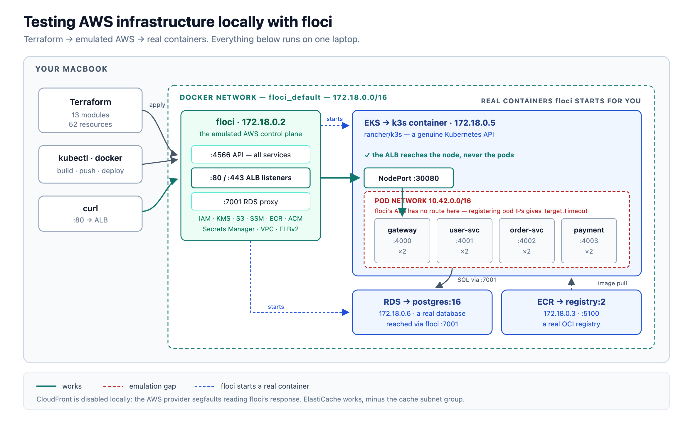

# floci-aws-demo

A complete AWS microservices stack — VPC, EKS, RDS, ALB, ECR, S3, KMS, Secrets
Manager, SSM — described in Terraform and applied entirely on a laptop against
[floci](https://floci.io), a local AWS emulator. No AWS account, no cloud spend.

**52 Terraform resources. 4 Node microservices. One `docker compose up`.**



## Why bother

Terraform's feedback loop against real AWS is brutal: an EKS cluster takes ~15
minutes to create and ~10 to destroy, so a typo in a security group rule costs
half an hour. Running the same config locally turns that into seconds, and it
means you can put `terraform apply` in a test suite.

The catch is fidelity. An emulator that accepts your API calls but doesn't
behave like AWS gives false confidence. This repo is as much a record of *where
floci's fidelity ends* as it is a demo — see [Gotchas](#gotchas).

## Quickstart

Requires Docker Desktop, Terraform ≥ 1.10, the AWS CLI, and kubectl.

```bash
git clone https://github.com/elokac/floci-aws-demo.git
cd floci-aws-demo

# 1. start floci
docker compose up -d

# 2. build the whole stack: terraform apply -> images -> k8s -> ALB -> frontend
./scripts/rebuild-all.sh
```

Then exercise it end to end:

```bash
ALB=$(terraform output -raw alb_dns_name)

curl -s -X POST "http://$ALB/api/users" \
  -H 'Content-Type: application/json' \
  -d '{"name":"ada","email":"ada@example.com"}'

curl -s -X POST "http://$ALB/api/orders" \
  -H 'Content-Type: application/json' \
  -d '{"user_id":1,"item":"widget","amount_cents":4200}'
```

A `201` with `"status":"paid"` means the whole chain worked: ALB → gateway →
order-service → Postgres → payment-service → back.

## What you get

| Layer | Terraform | What floci actually runs |
|---|---|---|
| Network | VPC, 4 subnets, IGW, route tables, SGs | metadata only |
| Compute | EKS cluster + node group | a real **k3s** container |
| Data | RDS Postgres | a real **postgres:16** container |
| Registry | 5 ECR repositories | a real **registry:2** container |
| Traffic | ALB, 2 listeners, target group | an HTTP proxy on `:80`/`:443` |
| Cache | ElastiCache Redis replication group | in-process emulation |
| Config | KMS, Secrets Manager, 7 SSM params | in-process emulation |
| Static | S3 bucket, policy, SSE, versioning | in-process emulation |

The interesting column is the third one. floci doesn't fake EKS — it starts
k3s and hands you a genuine Kubernetes API. Same for RDS and ECR. That's why
the app is really running, not merely "created".

## Layout

```
.
├── main.tf  variables.tf  outputs.tf  providers.tf
├── modules/          13 Terraform modules, one per service
├── services/         4 Node services + the static frontend
│   ├── gateway/          :4000  proxies to the others
│   ├── user-service/     :4001  Postgres
│   ├── order-service/    :4002  Postgres + optional Redis
│   └── payment-service/  :4003  mock charges
├── k8s/              Deployments/Services (01-config.yaml is generated)
├── scripts/          build, deploy, register, rebuild
└── verify.sh         inventory + functional checks + drift detection
```

## Scripts

| Script | Does |
|---|---|
| `scripts/rebuild-all.sh` | everything below, in order — safe to re-run; `--clean` to destroy first |
| `scripts/build-and-push.sh` | builds 4 images, pushes to local ECR |
| `scripts/deploy.sh` | kubeconfig, renders config, applies manifests, sets images |
| `scripts/render-k8s-config.sh` | generates `k8s/01-config.yaml` from live outputs + Secrets Manager |
| `scripts/register-alb-targets.sh` | registers the k3s NodePort with the ALB target group |
| `scripts/deploy-frontend.sh` | injects the ALB DNS into the frontend, syncs to S3 |
| `verify.sh` | 23 functional checks — round-trips, not just `describe-*` calls |

`verify.sh` deliberately does **round-trips**: it encrypts and decrypts through
KMS, writes and reads back an S3 object, and runs a real query against
Postgres. A `describe-*` call would pass against a stub.

## Gotchas

Seven real bugs surfaced building this. Each is documented inline where it bites.

**1. `count` on an unknown value.** `count = var.acm_certificate_arn != "" ? 1 : 0`
fails because the ARN is `(known after apply)`. Gate on an input variable, not
a resource attribute. → [`modules/alb/main.tf`](modules/alb/main.tf)

**2. The AWS provider segfaults on floci's CloudFront.** floci returns a
`DistributionConfig` with no `OriginGroups` field; provider v6.61.0 dereferences
it unguarded at `distribution.go:1150` and the plugin dies mid-apply, taking
in-flight resources with it. Not fixable from Terraform — CloudFront is
disabled locally. → [`terraform.tfvars`](terraform.tfvars)

**3. ElastiCache works, but reports its endpoint somewhere else.** Only
`CreateCacheSubnetGroup` is unsupported (`UnsupportedOperation`) — replication
groups apply fine. The catch is that floci returns the address on
`ConfigurationEndpoint` while real AWS puts it on
`NodeGroups[].PrimaryEndpoint`, so `primary_endpoint_address` comes back null.
The module coalesces both, and skips only the subnet group locally. →
[`modules/elasticache/main.tf`](modules/elasticache/main.tf)

**4. Tab is IFS whitespace.** Reading `user\t\tdbname` with `IFS=$'\t' read -r a b c`
silently collapses the empty field and shifts every value left — the database
name landed in the password variable. Use `\x1f`. →
[`scripts/render-k8s-config.sh`](scripts/render-k8s-config.sh)

**5. `COPY` preserves host file permissions.** A `0600` `server.js` on the host
becomes unreadable inside the image once the Dockerfile drops to `USER node`.
Use `COPY --chown --chmod`. → [`services/*/Dockerfile`](services/gateway/Dockerfile)

**6. Untagged images default to `imagePullPolicy: IfNotPresent`.** Kubernetes
only defaults to `Always` for a literal `:latest` tag. A placeholder image name
bakes `IfNotPresent` into the Deployment template, and `kubectl set image`
never changes it — so every rollout silently re-ran a cached image and the fix
for #5 appeared to do nothing. → [`k8s/10-gateway.yaml`](k8s/10-gateway.yaml)

**7. The ALB can't reach pod IPs.** `target_type = "ip"` is correct for real
EKS, where the AWS Load Balancer Controller registers pods directly. floci's
ALB runs in the floci container, which has no route to k3s's `10.42.0.0/16`, so
pod targets always report `Target.Timeout`. The workaround is a NodePort — and
it's a workaround, not a pattern to carry to production.

## Caveats

- **floci keeps no state across restarts.** Recreating the container discards
  everything while `terraform.tfstate` survives, leaving state describing
  infrastructure that no longer exists. `verify.sh` detects this and tells you
  to rebuild.
- **RDS shows perpetual drift.** floci doesn't persist `storage_encrypted` or
  `kms_key_id`, so every plan wants to replace the instance.
- **The demo DB password is a throwaway.** It lives in `variables.tf` for
  zero-setup cloning. A `check` block refuses it if `floci_endpoint` points
  anywhere other than localhost.

## Licence

MIT.
