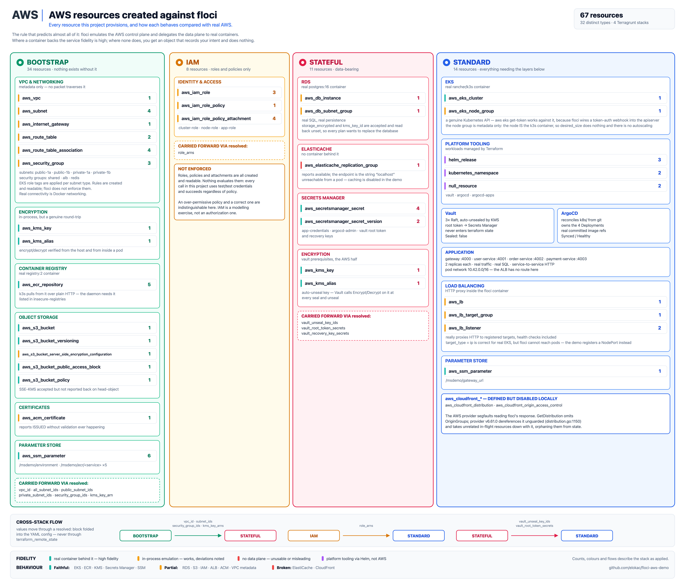
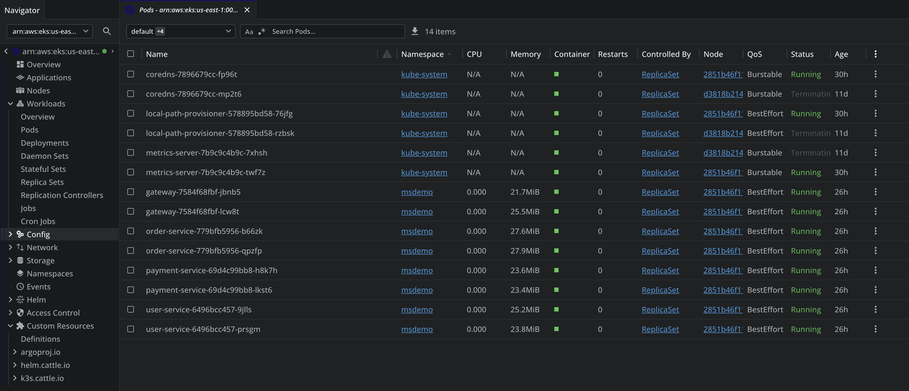
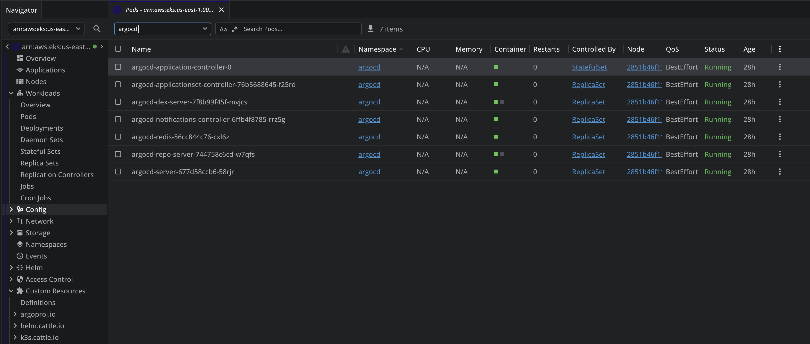
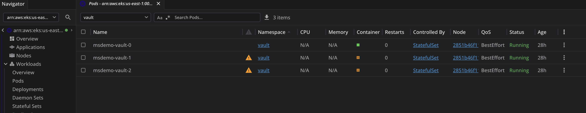

# AWS resources created against floci

Every resource this project provisions, and how each behaves compared with real
AWS. Everything below was observed by running the stack, not taken from
documentation.

**67 resources across 32 distinct types, in four Terragrunt stacks.**

*Drawn by [`scripts/gen-aws-resources.py`](../scripts/gen-aws-resources.py),
which refuses to render if the per-row counts, the per-stack subtotals and the
67 in the header disagree. The colour on the left edge of each row is fidelity:
teal = a real container backs it, amber = works with a documented deviation,
red = no data plane, purple = platform tooling via Helm rather than AWS.*

---

## 1. What gets created

| Resource type | bootstrap | iam | stateful | standard |
|---|--:|--:|--:|--:|
| `aws_vpc` | 1 | | | |
| `aws_subnet` | 4 | | | |
| `aws_internet_gateway` | 1 | | | |
| `aws_route_table` | 2 | | | |
| `aws_route_table_association` | 4 | | | |
| `aws_security_group` | 3 | | | |
| `aws_kms_key` | 1 | | 1 | |
| `aws_kms_alias` | 1 | | 1 | |
| `aws_ecr_repository` | 5 | | | |
| `aws_s3_bucket` | 1 | | | |
| `aws_s3_bucket_versioning` | 1 | | | |
| `aws_s3_bucket_server_side_encryption_configuration` | 1 | | | |
| `aws_s3_bucket_public_access_block` | 1 | | | |
| `aws_s3_bucket_policy` | 1 | | | |
| `aws_acm_certificate` | 1 | | | |
| `aws_ssm_parameter` | 6 | | | 1 |
| `aws_iam_role` | | 3 | | |
| `aws_iam_role_policy` | | 1 | | |
| `aws_iam_role_policy_attachment` | | 4 | | |
| `aws_db_instance` | | | 1 | |
| `aws_db_subnet_group` | | | 1 | |
| `aws_elasticache_replication_group` | | | 1 | |
| `aws_secretsmanager_secret` | | | 4 | |
| `aws_secretsmanager_secret_version` | | | 2 | |
| `aws_eks_cluster` | | | | 1 |
| `aws_eks_node_group` | | | | 1 |
| `aws_lb` | | | | 1 |
| `aws_lb_target_group` | | | | 1 |
| `aws_lb_listener` | | | | 2 |
| `helm_release` | | | | 3 |
| `kubernetes_namespace` | | | | 2 |
| `null_resource` | | | | 2 |
| **Total** | **34** | **8** | **11** | **14** |

`aws_cloudfront_distribution` and `aws_cloudfront_origin_access_control` are
defined but disabled locally (see below). The `helm_release`,
`kubernetes_namespace` and `null_resource` entries are Vault and ArgoCD.

---

## 2. Behaviour compared with real AWS

The single rule that predicts almost all of this: **floci emulates the AWS
control plane and delegates the data plane to real containers.** Where a
container backs the service, fidelity is high. Where none does, you get a
control-plane object that records your intent and does nothing.

Legend. **Faithful**: behaves as AWS does for this project's purposes ·
**Partial**: works, with a documented deviation · **Broken**: unusable.

| Service | Backed by | Verdict | How it differs from real AWS |
|---|---|---|---|
| **EKS** | real `rancher/k3s` container | Faithful | A genuine Kubernetes API. `aws eks get-token` works because floci wires a token-auth webhook into the apiserver. **Node groups are metadata only**: the "node" is the k3s container itself, so `desired_size` has no effect and there is no autoscaling. |
| **RDS** | real `postgres:16` container | Partial | A genuine database; real SQL, real persistence. **`storage_encrypted` and `kms_key_id` are not persisted**: they read back unset and force replacement on every plan. The endpoint is a docker-internal address reached through a floci proxy port, not resolvable DNS. |
| **ECR** | real `registry:2` container | Faithful | Real image push and pull; k3s pulls from it. Plain HTTP, so the daemon needs it in `insecure-registries`. Image scanning is not implemented. |
| **KMS** | in-process | Faithful | Encrypt/decrypt round-trips correctly, including from inside a pod, which is how Vault's `awskms` auto-unseal works against it. Key rotation and grants are not exercised. |
| **S3** | in-process | Partial | Put/get/delete round-trip correctly. **SSE-KMS is accepted but not reported back** on `head-object`, so encryption cannot be verified through the API. |
| **Secrets Manager** | in-process | Faithful | Create, put and get all work, including JSON payloads. Rotation, replica regions and resource policies are untested and unlikely to be implemented. |
| **SSM Parameter Store** | in-process | Faithful | Parameters write and read back correctly. `SecureString` + KMS not verified. |
| **IAM** | in-process | Partial | Roles, policies and attachments are all created and readable. **Nothing is enforced**: every call in this project uses `test`/`test` credentials and succeeds regardless of policy. IAM here is a modelling exercise, not an authorization one. |
| **ELBv2 (ALB)** | HTTP proxy in floci | Partial | Really proxies HTTP to registered targets, health checks included. **It has no route to the k3s pod CIDR (`10.42.0.0/16`)**, so `target_type = "ip"`, correct for real EKS, always yields `Target.Timeout`. The demo registers a NodePort instead. |
| **ACM** | in-process | Partial | Certificates are created and report `ISSUED` without DNS validation. No real TLS material is produced, so nothing can actually terminate TLS with them. |
| **VPC / subnets / routing / SGs** | in-process | Faithful *as metadata* | All objects are created, tagged and queryable, and EKS subnet-role tags are honoured. **No packet ever traverses them**. Real connectivity is Docker networking. Security group rules are not enforced. |
| **ElastiCache** | **nothing** | Broken | The replication group applies, but the endpoint it returns is unusable. See below. |
| **CloudFront** | **nothing** | Broken | The API accepts a distribution, but the AWS provider **segfaults** reading the response back. Disabled locally. |

### What that "Faithful" verdict on EKS actually looks like

`aws eks describe-cluster` is emulated. Everything reached through the
kubeconfig it produces is a genuine Kubernetes API, and an off-the-shelf cluster
browser talks to it without knowing anything about floci.

Four services at two replicas each, scheduled onto the k3s node, pulling their
images from the emulated ECR and reporting real memory, alongside k3s's own
`coredns`, `local-path-provisioner` and `metrics-server`.

The three rows marked `Terminating` at 11 days are not part of the demo. They
are [divergence 6](floci-gaps.md#6-floci-discards-all-state-when-its-container-is-recreated)
caught in the act: pods bound to a node whose container was replaced when floci
was recreated.

Seven ArgoCD pods, reconciling the four application Deployments from committed
manifests. Nothing about this is emulated. Terraform's `helm_release` installed
a real chart, and ArgoCD is doing real work against a real API server.

Vault is the same: three Raft peers, each of which had to call `kms:Decrypt`
against the emulator and get real ciphertext back before it would unseal.

---

## 3. The two that genuinely fail

### ElastiCache returns an endpoint that does not exist

`CreateReplicationGroup` succeeds and Terraform manages the resource. But:

- the address arrives on `ConfigurationEndpoint`, not `NodeGroups[].PrimaryEndpoint`
  (the reverse of real AWS for a non-clustered group), so
  `primary_endpoint_address` is `null`
- its value is the literal string **`localhost`**, and nothing listens there
- `CreateCacheSubnetGroup` returns `UnsupportedOperation`
- the requested `port` is ignored; floci allocates its own, which forces a
  replacement on every plan
- `num_cache_clusters` always reads back as `0`, and `IncreaseReplicaCount` is
  unsupported, so reconciling it fails the apply

This is the most dangerous category of emulator behaviour: **not an error, but a
plausible wrong answer.** A `describe-*` check reports the cache `available`, and
`localhost` is not an address anything can use: to a client inside the cluster
it is that client's own loopback.

### CloudFront crashes the AWS provider

`GetDistribution` omits `OriginGroups`. Provider v6.61.0 dereferences it without
a nil check at `distribution.go:1150`, so the plugin segfaults during the
post-create read, taking unrelated in-flight resources down with it and
orphaning them from state. There is no Terraform-side fix.

---

## 4. Summary

**What floci is genuinely good for.** Iterating on Terraform. The structure of a
configuration (module wiring, `for_each` keys, variable types, dependency
ordering, `count` on unknown values) is exercised faithfully, and the loop is
seconds rather than the fifteen-to-twenty-five minutes an EKS cluster costs on
real AWS.

Because EKS, RDS and ECR are real software, what runs on the infrastructure is
genuinely exercised too: real images pulled from a real registry, a real
scheduler, real SQL. Vault auto-unsealing through the emulated KMS is a real
cryptographic round-trip, not a recorded intention.

**What it cannot tell you.** Anything about correctness *as AWS*:

- **IAM is not enforced.** A policy that is far too permissive, or missing
  entirely, behaves exactly like a correct one.
- **Security groups and NACLs are not enforced.** Network isolation is
  unverifiable; a wide-open rule looks identical to a tight one.
- **No TLS, no real DNS, no cross-region, no quotas, no billing.**
- **Some resources are shape-only.** Node groups do not scale, ACM certificates
  are never validated, VPC routing moves no packets.
- **A green result can be a lie.** ElastiCache is the proof: the control plane
  reported healthy while the data plane did not exist.

**The mental model that works:** treat it as a fast unit-test tier, not a staging
environment. Unit tests do not prove a system works in production either; they
fail fast on the mistakes that do not need production to find, which is most of
them.

And learn where the emulation stops *before* trusting a green run. For floci the
rule is simple. If a real container backs the service, fidelity is high; if not,
you are talking to a bookkeeping layer. Ten minutes with `docker ps` tells you
which is which.

---

For each divergence in detail, with severity, the exact API behaviour and how
this project works around it, see [floci-gaps.md](floci-gaps.md).
