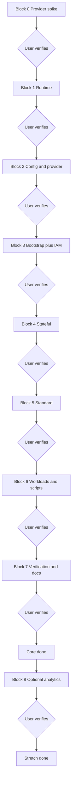

# GCP Local Implementation Plan (floci-gcp)

Status: plan only. No implementation until confirmed. Source of truth for design is the GCP local env architecture doc. AWS behavior stays untouched.

## Note to agents (user fills before execution)

Assignee: single Agent named here.
Branch and working directory: filled here.
Environment defaults: client name, environment name, GCP project, GCP endpoint, in-cluster endpoint, fake token.
Confirmations required before: creating the compose service, applying any stack, pushing images, touching shared files.
Doc authority: during implementation the Agent refers to the floci-gcp documentation for emulator behavior. If required information is not found in the first attempt, the Agent consults the User before proceeding.
User test gate: after each block the Agent informs the User with block outputs and acceptance evidence, then waits. The User tests and verifies status. The next block starts only after User approval. A git commit happens only on explicit User commit confirmation for that block, with an industry standard concise message describing the outcome, with no reference to code.
Live journal: during implementation the Agent keeps an append-only journal at docs/gcp-journal.md. Each entry records date-time UTC, agent name, model ID, block and phase, work summary, final status, files changed, new files, token usage as input plus output plus total counts, and User sign-off status.
Shared-file rule: additive only. The AWS terragrunt tree, AWS terraform modules, AWS compose service, AWS state, AWS outputs file and AWS make targets are read-only.
Definition of done per block: plan is clean, apply succeeds from empty state, verification round-trips pass, AWS regression passes, User sign-off recorded, journal updated, commit made only on explicit User commit confirmation.

## Goals and guardrails

Goal: run a GCP env locally beside the working AWS env, reusing the same four services and the same stack pattern.

Non-goals: no AWS refactors, no shared module edits, no production GCP rollout, no Redis port, no Vault port.

Guardrails: parallel trees only; separate state subtree; separate outputs JSON; separate make targets; separate docker label scope; demo password never leaves localhost; no commits or pushes without explicit user confirmation.

## Execution model

Single Agent executes all blocks in order. Each block lists inputs, outputs and acceptance so any agent can execute it.

Gate rule: after each block the Agent informs the User with outputs plus acceptance evidence and stops. The User tests and verifies status. The next block starts only after User approval. A commit for the block happens only on explicit User commit confirmation.

Shared contracts in the integration points section are frozen before the Agent starts applying.

## Standalone building blocks

| Block | Input | Output | Acceptance | Gate |
|---|---|---|---|---|
| 0. Provider spike | Architecture fidelity section; vendor custom endpoint notes | Capability matrix per service as supported, degraded or unsupported; GKE credential and kubeconfig flow; SQL ports and addresses; load balancer coverage verdict; k3s pull proof from the emulated registry; per-service app data dependency record | Matrix recorded; credential flow proven; pull proven from k3s; dependency record complete; resource table frozen on evidence | Inform User, User verifies, journal update, commit only on explicit confirmation |
| 1. Emulator runtime | Block 0 addresses and storage verdict | Additive compose service on its own port with socket mount, data volume and hostname settings; start and clean commands scoped to GCP label; storage mode rule plus reset command | Endpoint reachable from host; sidecars spawnable; AWS service unaffected; memory mode for verification runs and hybrid for interactive dev only | Inform User, User verifies, journal update, commit only on explicit confirmation |
| 2. Config and provider | Block 0 endpoint paths | GCP env config; env defaults file; root config; google provider template; single YAML string input; enumerated compat gate list by file and field; read-time secret substitution | Only proven endpoints wired; local endpoint yields versioned custom endpoints; no credential on disk; every local workaround appears in the gate list | Inform User, User verifies, journal update, commit only on explicit confirmation |
| 3. Bootstrap plus IAM | Frozen resource table; architecture stacks section | Bootstrap composite and modules for network, KMS ring and key, registries, bucket, service enables; IAM composite and modules for service accounts, bindings and pod access mechanism; leaf configs with resolved merge and mock outputs | Plan clean via mocks; contract outputs present; pod access explicit as binding or documented bypass | Inform User, User verifies, journal update, commit only on explicit confirmation |
| 4. Stateful | Block 0 dependency record plus handed-off network and KMS outputs | Cloud SQL instance, database and user; Firestore database; PubSub topics and subscriptions; assembled Secret Manager secrets; scope follows the dependency record | Secrets assemble without direct remote reads; SQL accepts connections; PubSub API round-trips pass; no consumer left unwired | Inform User, User verifies, journal update, commit only on explicit confirmation |
| 5. Standard | Handed-off bootstrap and stateful outputs | GKE cluster and node pool; Cloud Run service; ArgoCD releases and namespaces; URL outputs; NodePort plus probe as primary access | Targeted cluster apply then kubeconfig then full apply works; re-plan stable; gateway reachable without load balancer Terraform | Inform User, User verifies, journal update, commit only on explicit confirmation |
| 6. Workloads and scripts | Standard outputs | GCP kustomize overlay with registry addresses; gitignored rendered config; build and push flow; deploy flow with explicit restart; NodePort registration flow; frontend sync to GCS; outputs merge helper | Four services run on GKE; gateway reachable after registration; ArgoCD owns overlay path | Inform User, User verifies, journal update, commit only on explicit confirmation |
| 7. Verification and docs | All prior outputs | GCP verification script with round-trips plus freshness and drift checks; confirmed divergence notes; reconciled resource table | All round-trips pass; AWS verify still passes; planned counts match observed or table corrected with reasons | Inform User, User verifies, journal update, commit only on explicit confirmation |
| 8. Optional stretch | Blocks 4 and 5 outputs | BigQuery dataset and tables; Cloud Run job; compute load balancer Terraform if proven | Blocked out of the app critical path; attempted only after Block 7 sign-off | Inform User, User verifies, journal update, commit only on explicit confirmation |

## Integration points (frozen contracts)

Config schema: one YAML input per stack; global section carries project, location, endpoint URLs, compat flag and labels; per-stack sections carry lists for network, KMS, registries, buckets, service accounts, SQL, Firestore, PubSub, secrets, BigQuery, GKE, load balancer, Cloud Run and platform releases.

Resolved merge: upstream outputs fold into a resolved map under the same YAML document. Downstream composites never read remote state directly. Mock outputs keep plan working before upstream apply.

State paths: GCP state lives under a gcp state subtree per environment and stack, separate from AWS state. No shared state files.

Outputs JSON: GCP outputs merge into a separate GCP outputs file with stable keys for project, network, registry addresses, bucket, SQL endpoint, secret names, PubSub names, BigQuery names, cluster name, backend address and frontend URL. Scripts read by key name only.

Endpoints: host tooling uses localhost on the GCP port; in-cluster clients use the compose DNS name on the GCP port. Terraform custom endpoints carry API version suffixes. Fake token is used for local auth only.

Compat flag: true means local-emulator behavior with documented workarounds; false means production-correct config. Workarounds never leak into production config. Block 2 outputs the enumerated gate list by file and field; any new workaround requires updating the list.

Storage modes: verification runs default to memory mode; hybrid mode is for interactive dev only. Block 1 documents one reset command. Each gate records the storage mode used, so passes on stale state are visible.

IAM access: Block 3 specifies the pod access mechanism for Secret Manager and GCS, either the Kubernetes to GCP account binding or an explicitly documented emulator bypass. No implicit access.

Ports: GCP does not bind host ports 80 and 443 while the AWS ALB emulation holds them. Gateway access is verified via NodePort plus host probe with in-network fallback. The Cloud SQL host-side published range is decided and recorded in Block 1.

Namespace: Block 6 declares one GCP namespace and uses it in manifests, deploy, restart and the ArgoCD destination. The choice is recorded in the journal to avoid repeating the AWS namespace drift.

Registry auth: Block 6 documents the Artifact Registry docker login flow before build and push, and confirms the plain-HTTP insecure-registry requirement against the emulator.

Handoff order: Block 0 before all blocks; Block 1 before Block 2; Block 2 before Blocks 3 and 4; Block 3 outputs before Block 4; Blocks 3 and 4 outputs before Block 5; Block 5 outputs before Block 6; Block 6 before Block 7; Block 8 optional only after Block 7 sign-off. The resource table is frozen on Block 0 evidence. Each handoff is a User verification gate followed by journal update and commit only on explicit User commit confirmation.

## Resource mapping table (planned, not yet observed)

Planned: 61 resources across 31 distinct types, in four Terragrunt stacks plus one optional stretch stack. Table is provisional until the Block 0 spike freezes it, and Block 0 corrects any remaining arithmetic before freezing. Core counts are targets. Reconcile against real state in Block 7 like the AWS resource inventory does. Gates rest on contract outputs plus round-trips, not on exact totals.

| Resource type | bootstrap | iam | stateful | standard | stretch |
|---|--:|--:|--:|--:|--:|
| google compute network | 1 | | | | |
| google compute subnetwork | 2 | | | | |
| google compute firewall | 3 | | | | |
| google kms key ring | 1 | | | | |
| google kms crypto key | 1 | | 1 | | |
| google artifact registry repository | 5 | | | | |
| google storage bucket | 1 | | | | |
| google project service | 8 | | | | |
| google service account | | 3 | | | |
| google project iam member | | 5 | | | |
| google sql database instance | | | 1 | | |
| google sql database | | | 1 | | |
| google sql user | | | 1 | | |
| google firestore database | | | 1 | | |
| google pubsub topic | | | 2 | | |
| google pubsub subscription | | | 2 | | |
| google secret manager secret | | | 3 | | |
| google secret manager secret version | | | 2 | | |
| google container cluster | | | | 1 | |
| google container node pool | | | | 1 | |
| google cloud run v2 service | | | | 1 | |
| helm release | | | | 2 | |
| kubernetes namespace | | | | 2 | |
| null resource | | | | 2 | |
| Total core | 22 | 8 | 14 | 9 | |
| google compute backend service | | | | | 1 |
| google compute url map | | | | | 1 |
| google compute target http proxy | | | | | 1 |
| google compute global forwarding rule | | | | | 1 |
| google bigquery dataset | | | | | 1 |
| google bigquery table | | | | | 2 |
| google cloud run v2 job | | | | | 1 |
| Total stretch (Block 8) | | | | | 8 |

Core total is 53; grand total with stretch is 61.

Stretch is a separate fifth stack with its own state path. Block 8 never edits signed-off core composites.

Intentionally excluded from core Terraform: Cloud Functions and Cloud Tasks as shape-only control plane; Memorystore has no emulator equivalent. Helm, namespace and null entries cover ArgoCD and kubeconfig-dependent init. Compute load balancer Terraform, BigQuery dataset and tables, and the Cloud Run job are deferred to optional Block 8. Primary local access is NodePort plus host probe with in-network fallback. The 3 versus 2 secret-to-version count and the second KMS crypto key stay provisional until Block 0 maps each secret and version to a consumer and confirms whether one shared key suffices.

## Phase order and acceptance (each phase ends with User test gate, journal update, commit only on explicit confirmation)

| Phase | Scope | Acceptance | Gate |
|---|---|---|---|
| 0. Provider spike | Minimal resource per service; credential flow; app data dependencies | Matrix plus credential flow plus dependency record; table frozen on evidence | User verifies, commit only on explicit confirmation, journal update |
| 1. Runtime | Endpoint reachable; sidecars spawnable; AWS compose service unchanged | Reachability plus sidecar spawn confirmed; AWS diff empty | User verifies, commit only on explicit confirmation, journal update |
| 2. Config and provider | Only proven endpoints wired; plain provider for real GCP; no secret on disk | Provider generation matches endpoint mode; gate list complete | User verifies, commit only on explicit confirmation, journal update |
| 3. Bootstrap and IAM | Clean plan with mocks; contract outputs present; access explicit | Counts provisional; IAM shape-only confirmed | User verifies, commit only on explicit confirmation, journal update |
| 4. Stateful | SQL live query; secrets complete; PubSub round-trips; every consumer wired per dependency record | Live query plus API round-trips pass | User verifies, commit only on explicit confirmation, journal update |
| 5. Standard | Cold-start repeatable; re-plan stable; ArgoCD healthy; gateway reachable without load balancer Terraform | Targeted apply plus kubeconfig plus full apply succeeds | User verifies, commit only on explicit confirmation, journal update |
| 6. App | Four services at replicas; gateway reachable; frontend from GCS | Backend registration plus rollout confirmed | User verifies, commit only on explicit confirmation, journal update |
| 7. Verify and reconcile | GCP verification passes; AWS verification passes; table reconciled | Deltas explained or table corrected | User verifies, commit only on explicit confirmation, journal update |
| 8. Optional stretch | Load balancer Terraform if proven; BigQuery insert plus query; Cloud Run job execution | Attempted only after core sign-off; compute, dialect and execution risks isolated here | User verifies, commit only on explicit confirmation, journal update |

## Risks and unknowns

Custom endpoint paths need per-service confirmation including version suffixes. GKE credential and kubeconfig shape need confirmation against the emulator. Cloud SQL host-side range is decided and recorded in Block 1. Storage mode rule is memory for verification and hybrid for dev with one reset command. Load balancer resource coverage needs confirmation. BigQuery SQL subset and Cloud Run job execution are isolated in optional Block 8. NodePort workaround needs confirmation and must stay behind the compat flag.
