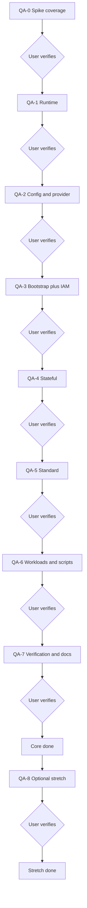

# GCP Test Development Plan (floci-gcp QA)

Status: plan only. No test implementation until confirmed. Source of truth for design is the GCP test plan plus the QA journal. Implementation behavior stays untouched: QA never edits impl trees, never applies.

## Note to agents (user fills before execution)

Assignee: single QA Agent named here.
Branch and working directory: `.worktree/gcp-qa` on branch `gcp-qa`; impl stays in main checkout on `gcp`.
Environment defaults: emulator base URL, GCP project, main-checkout state root, overlay dir, namespace, gateway URL.
Confirmations required before: adding new test files, changing minimum counts, touching shared files.
Doc authority: during test development the QA Agent refers to the floci-gcp documentation at https://floci.io/floci-gcp/services/ for emulator behavior. If required information is not found in the first attempt, the QA Agent consults the User before proceeding.
User test gate: after each QA phase the QA Agent informs the User with test outputs and acceptance evidence, then waits. The User tests and verifies status. The next phase starts only after User approval. A git commit happens only on explicit User commit confirmation for that phase, with an industry standard concise message describing the outcome, with no reference to code.
Live journal: during test development the QA Agent keeps an append-only journal at docs/gcp-tests-journal.md. Each entry records date-time UTC, agent name, model ID, block and phase, work summary, final status, files changed, new files, token usage as input plus output plus total counts, and User sign-off status.
Shared-file rule: additive only. The AWS terragrunt tree, AWS terraform modules, impl terraform modules, impl terragrunt stacks, impl compose service, impl state, and impl make targets are read-only to QA. All QA work lands under tests/gcp plus helper-pg probes.
Definition of done per phase: suite green for the phase scope, minimums set from observed plan-apply evidence, User sign-off recorded, journal updated, commit made only on explicit User commit confirmation.

## Goals and guardrails

Goal: prove each GCP implementation block with automated checks developed in parallel by a separate QA Agent in a worktree, reusing the same phase gates.

Non-goals: no impl refactors, no terraform applies from QA, no production GCP rollout, no app-code testing.

Guardrails: tests tree only; separate QA branch; shared emulator and cluster with impl; main state read via override, never written; demo password never asserted in output; no commits or pushes without explicit user confirmation.

## Execution model

Single QA Agent executes all QA phases in order inside `.worktree/gcp-qa`. Each phase lists inputs, outputs and acceptance so any agent can execute it.

Gate rule: after each phase the QA Agent informs the User with outputs plus acceptance evidence and stops. The User tests and verifies status. The next phase starts only after User approval. A commit for the phase happens only on explicit User commit confirmation.

Shared contracts in the integration points section are frozen before the QA Agent starts asserting.

## Standalone building blocks

| Phase | Input | Output | Acceptance | Gate |
|---|---|---|---|---|
| QA-0. Spike coverage | Block 0 capability matrix | Endpoint rows for every supported service in `test_emulator_endpoints.py` | Every matrix service has a probe; degraded notes recorded | Inform User, User verifies, journal update, commit only on explicit confirmation |
| QA-1. Runtime | Block 1 compose plus storage rule | Emulator identity test; sidecar presence checks in `TestDocker` | Info reachable; emulator plus sidecars present; AWS untouched | Inform User, User verifies, journal update, commit only on explicit confirmation |
| QA-2. Config and provider | Block 2 env plus gate list | Dual-mode render checks; no-secret-on-disk assertion | Both modes render; no credential tracked; gate list complete | Inform User, User verifies, journal update, commit only on explicit confirmation |
| QA-3. Bootstrap plus IAM | Frozen resource table; bootstrap outputs | State-type assertions plus bootstrap/IAM endpoint minimums | Contract outputs present; live counts match state | Inform User, User verifies, journal update, commit only on explicit confirmation |
| QA-4. Stateful | Block 0 dependency record; stateful outputs | Secrets, topics, subscriptions, SQL endpoint tests; round-trip tests | API round-trips pass; no consumer left unwired | Inform User, User verifies, journal update, commit only on explicit confirmation |
| QA-5. Standard | Standard outputs | Cluster, node pool, Run endpoint tests; k3s sidecar check | Cluster RUNNING; Run listed; re-plan stable | Inform User, User verifies, journal update, commit only on explicit confirmation |
| QA-6. Workloads and scripts | Standard outputs; overlay | `TestWorkloads` (overlay, pods, gateway via fallback, ArgoCD, leak guard) | Four services at replicas; gateway reachable; ArgoCD owns overlay path | Inform User, User verifies, journal update, commit only on explicit confirmation |
| QA-7. Verification and docs | All prior outputs | Round-trip suite plus drift, freshness, and reconcile tests | All round-trips pass; table matches observed; AWS verify passes | Inform User, User verifies, journal update, commit only on explicit confirmation |
| QA-8. Optional stretch | Blocks 4 and 5 outputs | Backend host-path, BigQuery subset, Run job tests behind scope flag | Stretch passes or limits documented; core unaffected | Inform User, User verifies, journal update, commit only on explicit confirmation |

## Integration points (frozen contracts)

Runner: `floci-pyenv/bin/python -m pytest tests/gcp -q` from the worktree with the main venv. Deps pinned in `tests/requirements.txt` and installed in `floci-pyenv`. Test code stays stdlib only.

Env overrides: `FLOCI_GCP_BASE`, `FLOCI_GCP_PROJECT`, `STATE_ROOT` (main checkout state), `OVERLAY_DIR` (main checkout overlay until manifests merge), `NAMESPACE`, `GATEWAY_URL`. Emulator and cluster are shared with impl; state is read-only.

Minimums: set only from observed plan-apply evidence, never guessed. Raising a minimum needs a new observation recorded in the journal.

Skips: emulator-down skips endpoint and workload classes; file and state classes still run. Completed-job pods count as ready.

Leak guard: rendered secret config must stay gitignored and untracked; the test fails the phase if tracked.

Handoff order: QA-0 with Block 0; QA-1 with Block 1; QA-2 with Block 2; QA-3 with Block 3 outputs; QA-4 with Block 4; QA-5 with Block 5; QA-6 with Block 6; QA-7 with Block 7; QA-8 optional only after QA-7 sign-off. Each handoff is a User verification gate followed by journal update and commit only on explicit User commit confirmation.

## Phase order and acceptance (each phase ends with User test gate, journal update, commit only on explicit confirmation)

| Phase | Scope | Acceptance | Gate |
|---|---|---|---|
| QA-0. Spike coverage | Probe per matrix service; degraded notes | Table rows complete; matrix mirrored | User verifies, commit only on explicit confirmation, journal update |
| QA-1. Runtime | Identity plus sidecars; AWS unaffected | Info plus docker checks green | User verifies, commit only on explicit confirmation, journal update |
| QA-2. Config and provider | Dual-mode render; no secret on disk | Render plus leak checks green | User verifies, commit only on explicit confirmation, journal update |
| QA-3. Bootstrap and IAM | State types plus live counts | Contract outputs plus endpoints green | User verifies, commit only on explicit confirmation, journal update |
| QA-4. Stateful | Data-plane endpoints plus round-trips | Live query plus API round-trips pass | User verifies, commit only on explicit confirmation, journal update |
| QA-5. Standard | Cluster, Run, re-plan stability | Platform checks green; re-plan stable | User verifies, commit only on explicit confirmation, journal update |
| QA-6. App | Overlay, pods, gateway fallback, ArgoCD | Full pytest green except QA-8 | User verifies, commit only on explicit confirmation, journal update |
| QA-7. Verify and reconcile | Round-trips, drift, freshness, reconcile, AWS regression | Zero undocumented failures | User verifies, commit only on explicit confirmation, journal update |
| QA-8. Optional stretch | Backend host path, BigQuery subset, Run job | Attempted only after core sign-off; risks isolated | User verifies, commit only on explicit confirmation, journal update |

## Risks and unknowns

Minimum counts drift when config changes; refresh from observed state only. Direct NodePort is a negative control on docker-hosted k3s; gateway proof uses port-forward until Block 8 registers the backend. ArgoCD sync needs a pushed revision; unpushed branches stay `Unknown`. Firestore stays SDK-only; BigQuery dialect limits are known-failure cases, not errors. Worktree overlay goes stale when manifests live uncommitted in main; override `OVERLAY_DIR` until merge.

Thought: goal mirrored QA dev plan, why same gates bind QA, next execute QA-7 with Block 7.
